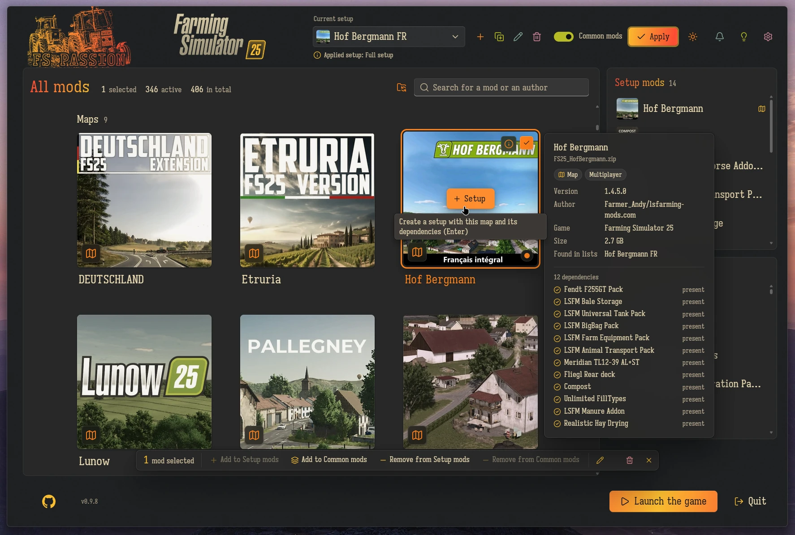
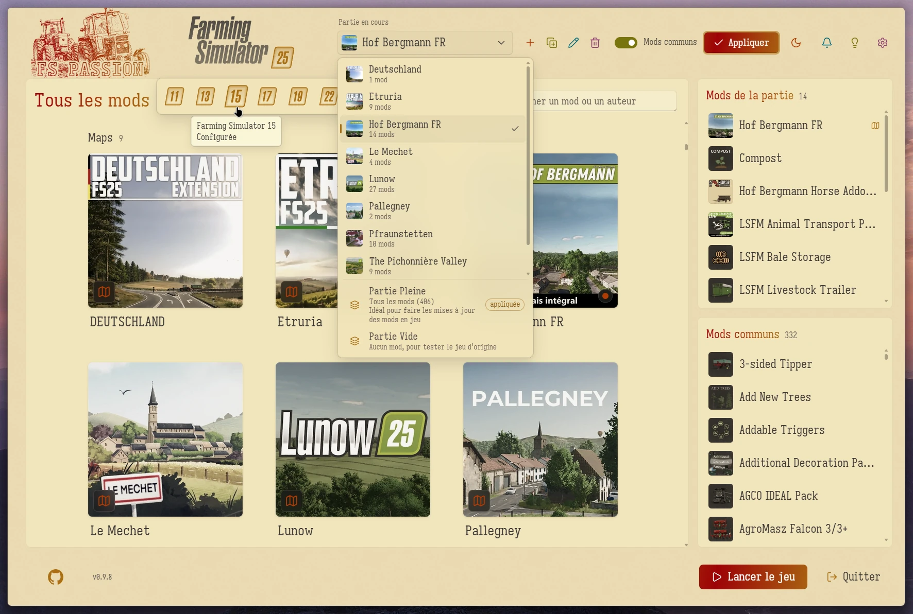
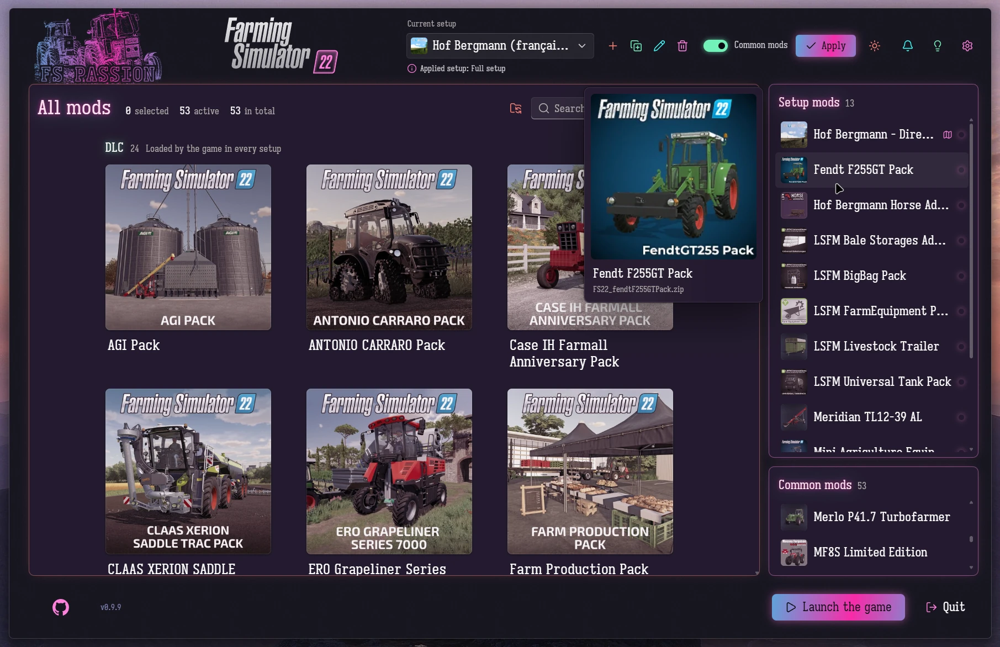
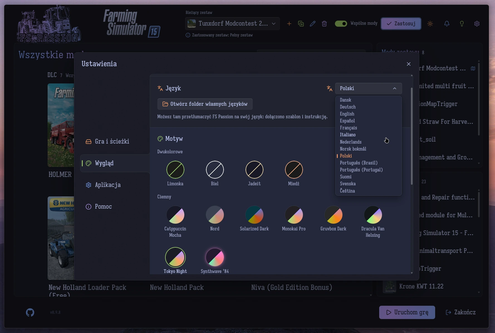
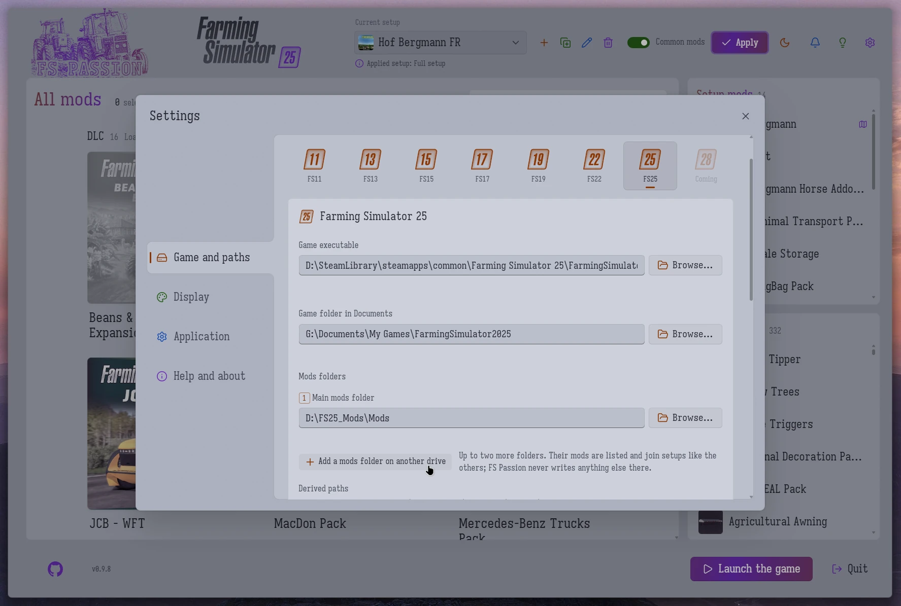
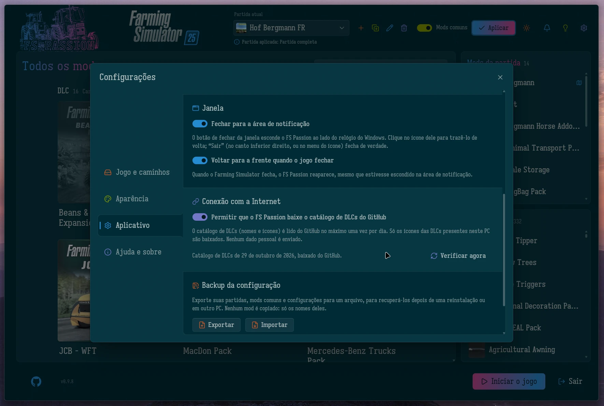

# FS Passion

[English](../README.md) · [Français](README.fr.md) · [Deutsch](README.de.md) · [Español](README.es.md) · [Español (Latinoamérica)](README.es-419.md) · [Italiano](README.it.md) · [Português (Brasil)](README.pt-BR.md) · [Português (Portugal)](README.pt-PT.md) · [Nederlands](README.nl.md) · **Polski** · [Čeština](README.cs.md) · [Dansk](README.da.md) · [Suomi](README.fi.md) · [Magyar](README.hu.md) · [Norsk bokmål](README.nb.md) · [Română](README.ro.md) · [Русский](README.ru.md) · [Svenska](README.sv.md) · [Türkçe](README.tr.md) · [Українська](README.uk.md) · [Tiếng Việt](README.vi.md) · [Bahasa Indonesia](README.id.md) · [日本語](README.ja.md) · [한국어](README.ko.md) · [简体中文](README.zh-Hans.md) · [繁體中文](README.zh-Hant.md)

Menedżer modów do Farming Simulator (od FS2011 do FS25), dla Windows 10 i 11.

Wadą Farming Simulator jest to, że oferuje tylko jeden folder modów, w którym gromadzi się wiele map i modów, czasem niezgodnych ze sobą. Przechodzenie z jednej konfiguracji gry do drugiej jest tak uciążliwe, że zniechęca do wypróbowywania nowych map.

Sercem FS Passion jest rozwiązanie tego problemu z zaskakującą skutecznością: w kilka kliknięć tworzysz **zestawy**, czyli kolekcje modów, i przełączasz się między nimi jednym kliknięciem. Wszystkie twoje mody zostają w jednym egzemplarzu w swoim pierwotnym folderze, folderze Mods.

- **Zestawy**: mapa, jej zależności i wybrane przez ciebie mody; **wspólne mody** dzielone przez wszystkie zestawy.
- **Aktualizacje**: te wykonane przez grę (ModHub) są przejmowane i śledzone we wszystkich zestawach; zastąpiona wersja jest odkładana na bok, nigdy usuwana.
- **Pobrane pliki**: nowe mody są wykrywane i przenoszone do folderu modów odpowiedniej wersji gry.
- **Kilka dysków**: do trzech folderów modów na różnych dyskach.
- **Kopia zapasowa konfiguracji**: eksport i import zestawów oraz ustawień, na potrzeby ponownej instalacji lub innego komputera.
- **Przewodnik**: żarówka w nagłówku przedstawia interfejs w minutę, z animowanymi przykładami (wersje, zestawy, listy, zaznaczanie wielu, przeciąganie i upuszczanie, skróty klawiszowe).
- **Przestań używać FS Passion**: gra odzyskuje oryginalne ustawienie, a foldery zestawów są usuwane; twoje mody nigdy nie są ruszane.
- Dwukolorowe **motywy** oraz motywy inspirowane popularnymi, ciemne i jasne (Catppuccin, Nord, Solarized, Monokai Pro, Gruvbox, Dracula, Tokyo Night, Synthwave '84).
- **Języki**: interfejs w 14 językach (English, Français, Deutsch, Español, Italiano, Português (Brasil), Português (Portugal), Nederlands, Polski, Čeština, Dansk, Suomi, Norsk bokmål, Svenska), wybierany według języka systemu Windows i zmieniany w Ustawieniach; możesz dodać własne tłumaczenie. **Wkrótce: 12 kolejnych języków**: Magyar, Română, Русский, Українська, Türkçe, Tiếng Việt, Bahasa Indonesia, Español (Latinoamérica), 日本語, 한국어, 简体中文, 繁體中文.
- **Demo**: aplikacja jest przeznaczona wyłącznie dla posiadaczy gier Farming Simulator. Jeśli jesteś ciekawy i chcesz wypróbować jej funkcje bez gry, w Ustawieniach znajdziesz pakiet demonstracyjny.

> ⚠️ Projekt w trakcie rozwoju (wersja: zobacz stronę [Releases](https://github.com/Michel-MichelMichel/FSPassion/releases)). Przed wypróbowaniem zrób pełną kopię zapasową folderu modów. Ta strona GitHub jest jedynym oficjalnym źródłem pobierania.

## Zrzuty ekranu

<table>
<tr>
<td width="50%"> Wszystkie mody danej wersji gry, karta informacji i zaznaczanie wielu modów</td>
<td width="50%"> Zestawy: przełączanie jednym kliknięciem (jasny motyw, interfejs po francusku)</td>
</tr>
<tr>
<td width="50%"> Duży podgląd po najechaniu myszą (FS22, motyw Synthwave '84)</td>
<td width="50%"> Motywy i języki (interfejs po polsku)</td>
</tr>
<tr>
<td width="50%"> Foldery modów na kilku dyskach</td>
<td width="50%"> Ustawienia: obszar powiadomień, połączenie z Internetem, kopia zapasowa (interfejs po portugalsku)</td>
</tr>
</table>

## Pobieranie

Na stronie [Releases](https://github.com/Michel-MichelMichel/FSPassion/releases):

- `FSPassion-X.Y.Z-setup.exe`: instalator, dla bieżącego użytkownika bez uprawnień administratora lub dla wszystkich użytkowników; w razie potrzeby instaluje Microsoft Edge WebView2 (Windows 10);
- `FSPassion-X.Y.Z-portable.zip`: wersja przenośna, bez instalacji; ustawienia i dzienniki zostają w folderze `data` obok `FSPassion.exe`;
- `SHA256SUMS.txt`: sumy kontrolne obu plików.

Pliki nie są jeszcze podpisane: przy pierwszym uruchomieniu Windows SmartScreen może wyświetlić ostrzeżenie; otwórz dodatkowe informacje i wybierz uruchomienie aplikacji mimo to. Bezpłatne podpisywanie przez SignPath Foundation jest planowane po pierwszej wersji.

## Pomóż ulepszyć tłumaczenia

Tłumaczenia są pierwszą wersją: poprawki od rodzimych użytkowników języka są bardzo mile widziane, zarówno dla obecnych języków, jak i dla tych, które dopiero się pojawią. Nie trzeba umieć programować, wystarczy edytor tekstu (Notatnik w zupełności wystarczy).

1. W tym repozytorium otwórz folder [`lang`](../lang/) i pobierz plik swojego języka (`pl.json`). Jeśli go jeszcze nie ma, pobierz `en.json`.
2. Umieść go w folderze własnych języków swojej instalacji FS Passion (otwiera go przycisk **Otwórz folder własnych języków** w Ustawienia → Wygląd → Język):
   - wersja instalowana: `%APPDATA%\FSPassion\lang\`;
   - wersja przenośna: `data\lang\` obok `FSPassion.exe`.
3. Zmień jego nazwę, na przykład na `pl_corrected.json` (nazwa nie może zaczynać się od `_`). Nie zmieniaj wiersza `"code"` na początku pliku: wtedy twój plik zastąpi wbudowany język. Jeśli zaczynasz od `en.json`: wpisz `"pl"` w wierszu `"code"` i `"Polski"` w wierszu `"name"`.
4. Popraw teksty w cudzysłowach, po prawej stronie znaków `:`, i zapisz plik (kodowanie UTF-8). Nie zmieniaj kluczy po lewej stronie ani słów w nawiasach klamrowych, takich jak `{count}`.
5. Uruchom ponownie FS Passion i wybierz swój język w Ustawienia → Wygląd → Język: jest oznaczony jako „własny”. Sprawdź swoje poprawki w interfejsie.
6. Wyślij poprawiony plik w zakładce [Issues](https://github.com/Michel-MichelMichel/FSPassion/issues): utwórz zgłoszenie zatytułowane na przykład „Translation: Polski” i dołącz plik (spakuj go do ZIP, jeśli GitHub odrzuci rozszerzenie `.json`).

## Zgłoś problem, zaproponuj pomysł

Zakładka [Issues](https://github.com/Michel-MichelMichel/FSPassion/issues). Przy problemie dołącz tekst z „Kopiuj diagnostykę” (Ustawienia → Pomoc → Dzienniki i diagnostyka).

## Wesprzyj projekt

FS Passion jest i pozostanie projektem godnym zaufania, otwartym i darmowym. Jednorazowa darowizna dla autora zajmuje kilka sekund, bez zakładania konta: [Buy Me a Coffee](https://buymeacoffee.com/michel.michelmichel) lub [darowizna kartą (Stripe)](https://donate.stripe.com/3cI00k2szgLvcx80Xdgfu00).

## Połączenie z internetem

FS Passion łączy się tylko z GitHubem, aby odczytać katalog DLC (nazwy i ikony, publiczne repozytorium `FSPassion-data`), najwyżej raz dziennie. Żadne dane osobowe nie są wysyłane. Ustawienie „Połączenie z internetem” (Ustawienia → Aplikacja) to wyłącza. Przy każdym uruchomieniu (potem raz dziennie) sprawdza też na GitHubie, czy jest nowa wersja FS Passion: ustawienie „Aktualizacje FS Passion” (Ustawienia → Aplikacja) to wyłącza.

## Licencja

FS Passion: **GPLv3** (plik `LICENSE`), autor MichelMichel. Dokumentacja dla programistów i pełne podziękowania (ikony, czcionki, motywy): [README po angielsku](../README.md).

FS Passion jest niezależnym projektem, niezwiązanym z GIANTS Software. Farming Simulator jest znakiem towarowym GIANTS Software.
